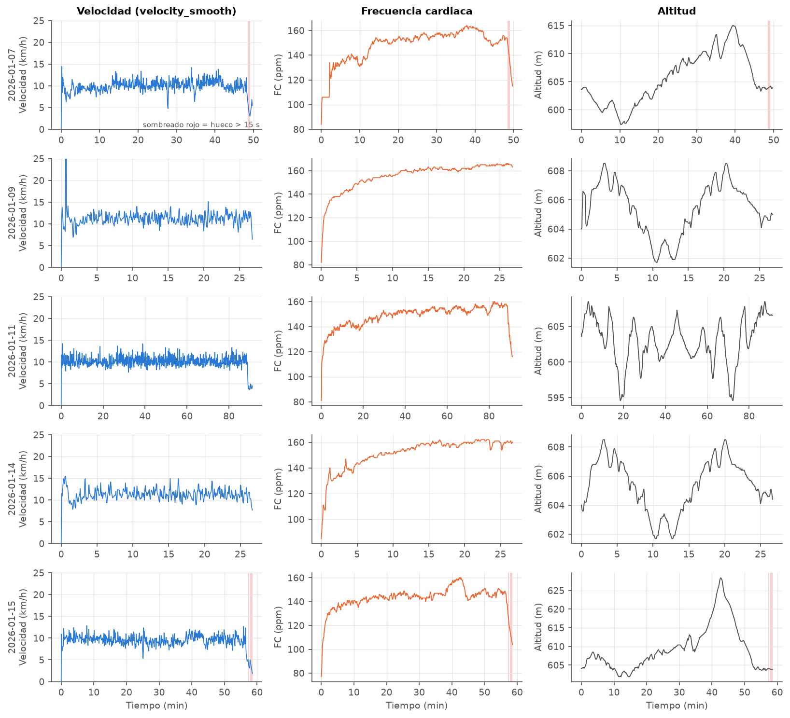
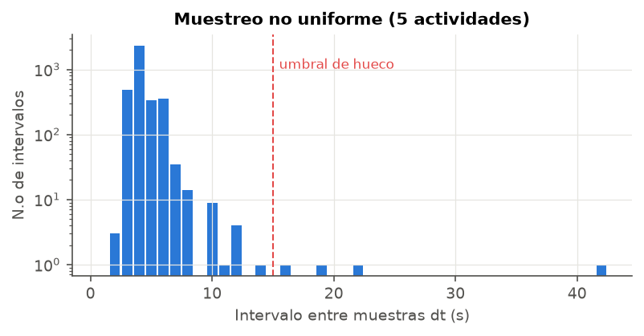

# Hito 1 — Análisis inicial de la señal

**Proyecto:** Registro de carrera · **Código:** `02_Codigo/hito1_analisis.py` · **Resultados numéricos:** `resultados.md`

## 1. Origen de los datos

Los datos son cinco actividades de carrera descargadas de la API de Strava con los scripts de `entrenamiento/` (`get_strava_data.py`). Para cada actividad se piden los *streams* `time`, `distance`, `heartrate`, `velocity_smooth` y `altitude`. He copiado los CSV a `01_Datos/` renombrándolos por fecha (`actividad_AAAA-MM-DD.csv`), porque los nombres originales llevan `:` y no se pueden abrir en Windows.

| Señal | Unidad | Sensor / origen |
|---|---|---|
| `time` | s | reloj, desde el inicio |
| `distance` | m | GPS (acumulada, calculada por Strava) |
| `heartrate` | ppm | banda de pecho / pulsómetro |
| `velocity` | m/s | GPS, **ya suavizada por Strava** (`velocity_smooth`) |
| `altitude` | m | GPS / barómetro |

Las columnas `speed_kmh` y `distance_km` del CSV son derivadas; en la carga las recalculo para no depender de ellas.

## 2. Representación temporal

En las cinco sesiones se ve la misma estructura:

- **Arranque**: la velocidad sube de 0 a ~10 km/h en unos segundos, pero la FC tarda varios minutos en estabilizarse (respuesta lenta del sistema cardiovascular, como un sistema de primer orden con una constante de tiempo de minutos).
- **Tramo central** a ritmo casi constante (9,5–11,5 km/h) con una fluctuación rápida de ±1–2 km/h que parece ruido del GPS más que cambios reales de ritmo.
- **Vuelta a la calma** andando al final en 07/01, 11/01 y 15/01 (velocidad < 6 km/h y la FC cae rápido).
- La FC sube lentamente durante toda la sesión aunque el ritmo no cambie (**deriva cardiaca**), muy visible en la tirada de 91 min del 11/01.
- 09/01 y 14/01 tienen **exactamente el mismo perfil de altitud**: es el mismo recorrido de 5 km, lo que permite compararlas directamente.
- 15/01 tiene una subida clara (+20 m) entre los minutos 35 y 43, y la FC sube a la vez.

## 3. Muestreo

**El muestreo no es uniforme.** El reloj usa "grabación inteligente": guarda un punto cuando cambia algo, no a intervalos fijos. El intervalo entre muestras vale 4 s de mediana (media 4,25 s), con el 95 % por debajo de 6 s y un máximo de 42 s. Esto tiene dos consecuencias para el resto del proyecto:

1. No se puede aplicar directamente un filtro digital ni la FFT, que suponen periodo de muestreo constante → en el Hito 2 hay que **remuestrear**.
2. La frecuencia de muestreo "efectiva" es de ~0,25 Hz, así que no hay información por encima de ~1/(2·4 s) = 0,125 Hz aunque luego se interpole a 1 Hz.

## 4. Anomalías detectadas

| Actividad | Muestras | Duración (min) | Distancia Strava (km) | dt máx (s) | Huecos > 15 s | Outliers v | v máx (km/h) | FC congelada (s) |
|---|---|---|---|---|---|---|---|---|
| 07/01 | 693 | 49,7 | 8,12 | 22 | 2 | 0 | 14,4 | 110 |
| 09/01 | 408 | 26,8 | 5,05 | 10 | 0 | 2 | **53,1** | 0 |
| 11/01 | 1305 | 91,1 | 15,14 | 14 | 0 | 0 | 14,2 | 0 |
| 14/01 | 398 | 26,7 | 5,00 | 7 | 0 | 0 | 15,5 | 0 |
| 15/01 | 771 | 58,6 | 9,13 | 42 | 2 | 0 | 12,9 | 0 |

**(a) Salto de GPS (outlier), 09/01, t = 38–42 s.** La velocidad llega a 32 y 53 km/h, físicamente imposible corriendo. Si derivo la distancia acumulada sale un pico de 93 km/h: la posición GPS "salta" unos 100 m y vuelve. No es solo un problema de la velocidad: **ese salto se suma a la distancia total** de la actividad. A la vez se ve un escalón en la altitud, lo que confirma que es un fallo del posicionamiento.

**(b) FC congelada, 07/01, t = 14–124 s.** La FC se queda clavada en 106 ppm durante 110 s y luego salta a 134. Es típico de la banda de pecho cuando todavía no hace buen contacto (piel seca al empezar): el reloj repite el último valor válido. En regímenes estables la FC (que es un entero) también se repite 20–40 s seguidos, pero sin el salto final; para no confundir ambos casos, en la detección exijo duración ≥ 60 s **y** salto ≥ 10 ppm al salir.

**(c) Huecos, 07/01 y 15/01.** Los intervalos de 22, 19 y 42 s aparecen siempre al final, cuando el corredor ya va andando. Al moverse despacio el reloj guarda menos puntos. No son pérdidas de señal en plena carrera, así que se pueden interpolar sin problema, pero hay que marcarlos.

**Drift / deriva**: no he visto deriva instrumental, pero sí la deriva **fisiológica** de la FC comentada antes. La altitud GPS tiene algo de ruido de alta frecuencia (escalones de 0,1–0,5 m) que, sin tratar, infla el desnivel acumulado (se cuantifica en el Hito 2).

No hay valores perdidos (NaN) ni tiempos repetidos o desordenados (se comprueba en `carga.cargar_actividad`).

## 5. Conclusiones del hito

- Señales: velocidad (ruidosa, con algún salto de GPS), FC (lenta, con una meseta artificial) y altitud (suave pero con ruido de cuantificación).
- Muestreo irregular de ~4 s → hay que remuestrear antes de filtrar.
- Anomalías a corregir: 2 outliers de velocidad (09/01), 110 s de FC congelada (07/01), 4 huecos al final de dos sesiones.
- Primera hipótesis sobre el tipo de sesión: 09/01 y 14/01 parecen **sesiones rápidas** de 5 km (más velocidad y FC más alta), 11/01 es una **tirada larga** (15 km) y 07/01 y 15/01 son **rodajes**.
