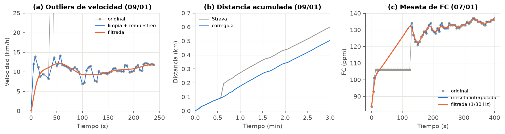
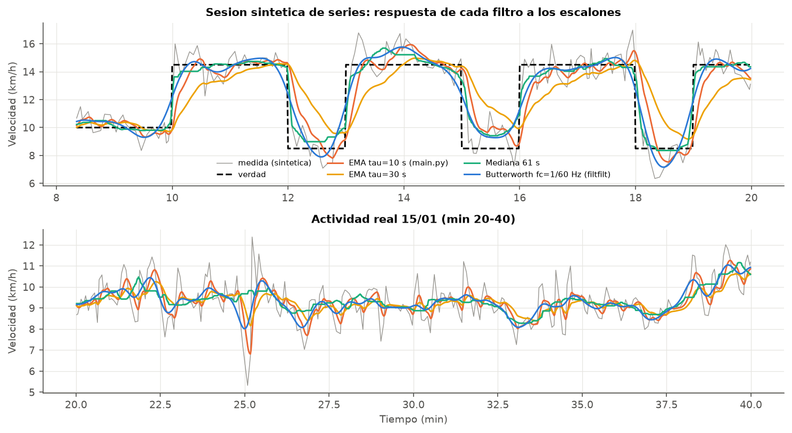
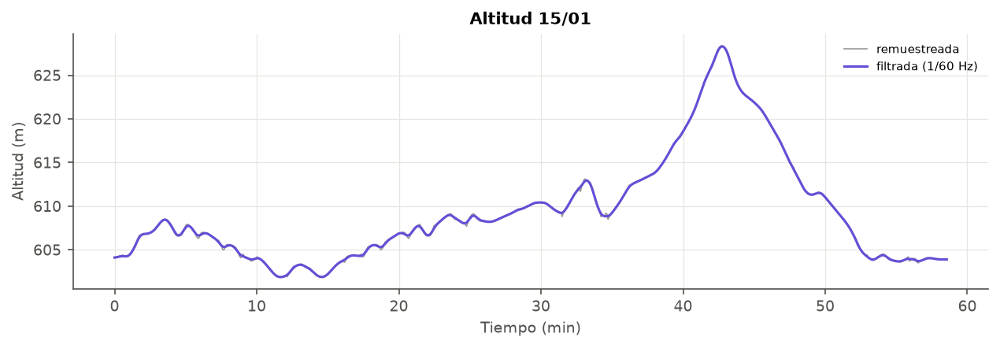

# Hito 2 — Preprocesado

**Código:** `02_Codigo/carrera/preprocesado.py` (funciones) y `02_Codigo/hito2_preprocesado.py` (figuras y tablas) · **Resultados:** `resultados.md`

## 1. Cadena de preprocesado

```
CSV ─► limpiar() ─► remuestrear(fs = 1 Hz) ─► paso_bajo() ─► señal lista para el Hito 3
        │                 │                        │
        │                 │                        └─ Butterworth orden 2, filtfilt
        │                 │                           v: fc = 1/60 Hz · altitud: 1/60 Hz · FC: 1/30 Hz
        │                 └─ interpolación lineal, marca de huecos > 15 s
        ├─ outliers de velocidad → NaN (límite físico 25 km/h + Hampel)
        ├─ FC congelada → NaN (meseta ≥ 60 s con salto ≥ 10 ppm al salir)
        └─ distancia corregida en los outliers
```

## 2. Limpieza



**Outliers de velocidad.** Combino dos criterios:

- *Límite físico*: v > 25 km/h es imposible para un corredor popular. No tiene parámetros que ajustar, pero solo detecta saltos muy grandes.
- *Filtro de Hampel* (ventana de 11 muestras, 4 desviaciones robustas, 1,4826·MAD) para picos más pequeños. Con un umbral bajo, Hampel también marcaría cambios de ritmo reales, así que solo acepto los picos **hacia arriba** de más de 1,5 veces la mediana local, que es como aparecen los saltos de GPS.

Los dos puntos del 09/01 (32 y 53 km/h) se eliminan y luego se rellenan por interpolación.

**Corrección de la distancia.** Strava calcula la distancia sumando posiciones GPS, así que el salto se queda en el total. En las muestras marcadas sustituyo el incremento de distancia por `v_interpolada · dt`. Resultado: **09/01 pasa de 5 052 m a 4 956 m (−96 m, −1,9 %)**. En el resto de sesiones no cambia nada. (Primero probé a reconstruir toda la distancia integrando la velocidad, pero `velocity_smooth` está suavizada y salía un sesgo de +0,5–0,9 % en todas las sesiones, así que lo descarté.)

**FC congelada.** Las muestras de la meseta del 07/01 se ponen a NaN y se interpolan linealmente entre 101 ppm (t = 8 s) y 134 ppm (t = 131 s). No es el valor real, pero es más razonable que una meseta seguida de un escalón de 28 ppm.

## 3. Remuestreo

Remuestreo todas las señales a una rejilla uniforme de **fs = 1 Hz** con interpolación lineal (`numpy.interp`). He elegido 1 Hz porque así una muestra equivale a un segundo y la indexación es directa. **Esta interpolación no añade información**: como el periodo original típico es de 4 s, por encima de ~0,125 Hz el contenido de la señal interpolada es solo un artefacto de la interpolación (se ve en los espectros como una caída brusca en esa frecuencia). Las muestras que caen en un hueco > 15 s se marcan (`en_hueco`) por si hace falta descartarlas.

## 4. Análisis espectral y elección de la frecuencia de corte


PSD estimada con Welch (ventanas de 1024 s) sobre la señal remuestreada:

- **Velocidad**: el espectro es casi **plano** hasta ~0,1 Hz y cae a partir de ~0,125 Hz (Nyquist efectivo). Un espectro plano indica ruido casi blanco: la mayor parte de la potencia por encima de 0,02 Hz es ruido del GPS, no cambios de ritmo. Los cambios de ritmo que interesan (series, tramos de ritmo, paradas) duran como mínimo ~1 min, es decir, están por debajo de **1/60 Hz ≈ 0,017 Hz** → esa es la frecuencia de corte que uso.
- **FC**: decae como 1/f² (señal lenta, de tipo "integrador"). Corto en 1/30 Hz para quitar el ruido de cuantificación sin deformar la subida inicial.
- **Altitud**: decae aún más rápido. Corto en 1/60 Hz, que conserva subidas de más de ~100 m de recorrido.

## 5. Elección del filtro

He comparado cuatro filtros paso bajo. Para poder medir el error hace falta saber cuál es la velocidad "real", así que he usado **20 sesiones sintéticas de series** (escalones conocidos, generadas con `carrera/sintetico.py` con un ruido similar al real: σ ≈ 1 km/h y autocorrelación ≈ 0,4, medidos en las sesiones reales).



| Filtro | RMSE frente a la verdad (km/h) | Retardo (s) |
|---|---|---|
| EMA τ = 10 s (el de `main.py`) | 1,32 | 9 |
| EMA τ = 30 s | 1,81 | 20 |
| Mediana de 61 s | **0,80** | 2 |
| **Butterworth fc = 1/60 Hz, filtfilt** | 0,93 | 2 |

- La **EMA** de `entrenamiento/main.py` es un filtro RC causal: con τ pequeño casi no quita ruido y con τ grande retrasa los eventos ~τ segundos (20 s para τ = 30 s). Para localizar *cuándo* cambia el ritmo, ese retardo es un problema.
- El **Butterworth con `filtfilt`** (se filtra hacia delante y hacia atrás) tiene **fase cero**: no desplaza los eventos. (Los 2 s de retardo que salen en la tabla se deben a la rampa de 1 muestra que meto en la señal sintética, no al filtro.)
- La **mediana** da el menor error en escalones porque es un filtro no lineal que conserva los bordes. Pero su salida es en escalera, no es un sistema lineal (no se puede interpretar con el espectro) y su derivada no está bien definida.

**Decisión:** uso **Butterworth de orden 2, fase cero, fc = 1/60 Hz** como señal suavizada para calcular indicadores (ritmo, eficiencia, pendiente), porque es lineal, su efecto está justificado con el espectro y no retrasa. La diferencia con la mediana es pequeña (0,13 km/h). Para **detectar cambios de ritmo** (Hito 4) no uso la señal filtrada, sino un método que trabaja con la señal sin filtrar, y así no pierdo la nitidez de los bordes.

## 6. Altitud y desnivel



Si se suman todas las diferencias positivas de la altitud, el ruido también suma desnivel. Comparación:

| Actividad | Σ dh > 0 bruta (m) | Filtrada (m) | Filtrada + histéresis 1 m (m) |
|---|---|---|---|
| 07/01 | 36,7 | 31,2 | 22,3 |
| 09/01 | 23,5 | 17,2 | 10,2 |
| 11/01 | 81,6 | 74,1 | 61,3 |
| 14/01 | 22,0 | 16,1 | 11,2 |
| 15/01 | 51,5 | 43,7 | 33,7 |

Con filtro + histéresis (solo se cuenta un cambio cuando la altitud se ha movido ≥ 1 m desde la última referencia) el desnivel baja un 25–55 %. 09/01 y 14/01, que son el mismo recorrido, pasan a dar un valor parecido (10–11 m), lo que me hace pensar que esta es la estimación más fiable.

## 7. Conclusiones del hito

- La limpieza elimina los 2 saltos de GPS, corrige 96 m de distancia falsa y la meseta de FC.
- El remuestreo a 1 Hz es necesario para filtrar, pero hay que recordar que el ancho de banda útil es < 0,125 Hz.
- fc = 1/60 Hz está justificada por el espectro (ruido casi blanco por encima) y por la escala temporal de los eventos que se quieren detectar.
- El Butterworth de fase cero es mejor que la EMA del código de partida: menos error (0,93 frente a 1,32 km/h) y sin retardo.
