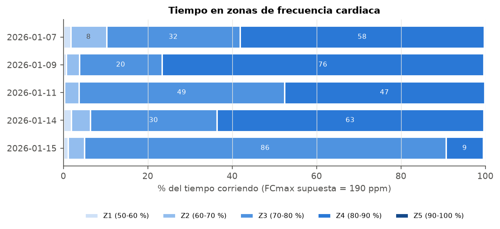
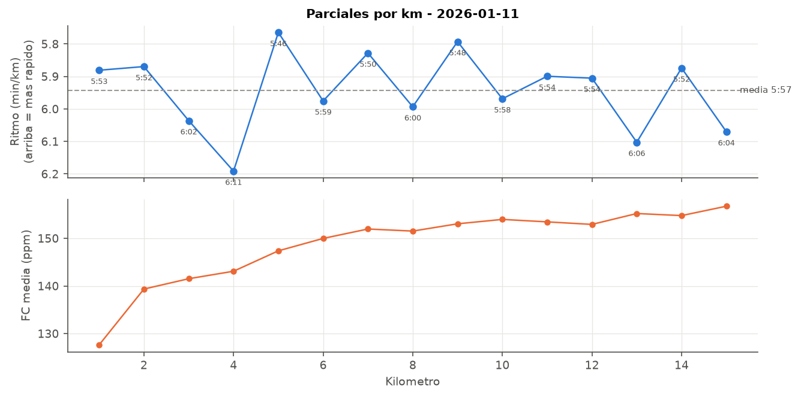
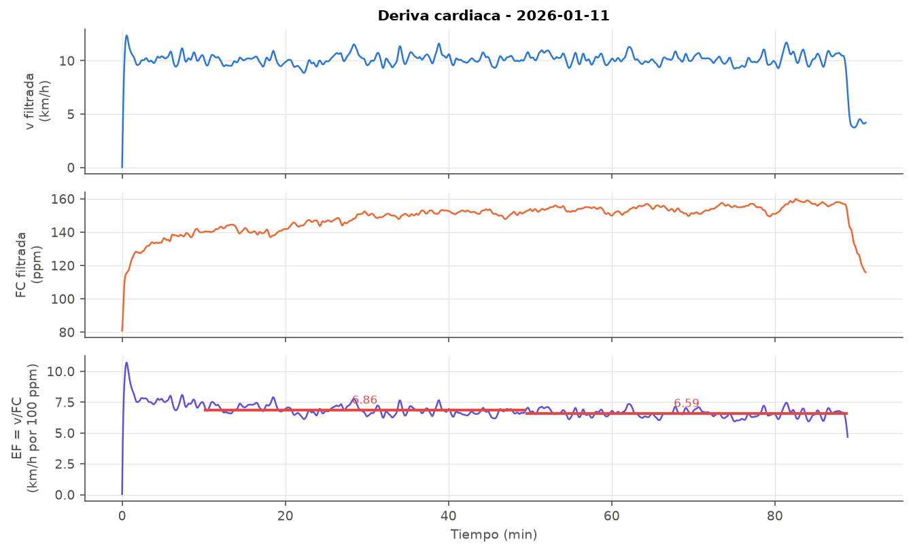
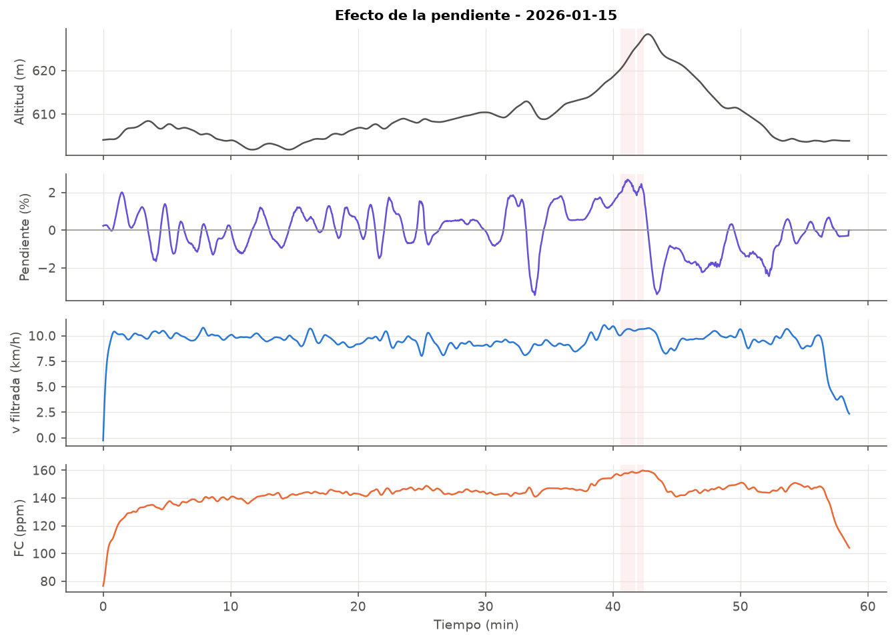

# Hito 3 — Extracción de características

**Código:** `02_Codigo/carrera/caracteristicas.py` y `02_Codigo/hito3_caracteristicas.py` · **Resultados:** `resultados.md`, `indicadores.csv`

## 1. Características calculadas

Todas se calculan sobre la señal preprocesada (Hito 2). "Corriendo" se refiere a las muestras con estado *corriendo* según el detector del Hito 4 (v filtrada > 7 km/h), así que la vuelta a la calma andando no cuenta en el ritmo medio.

| Característica | Cómo se calcula | Para qué sirve |
|---|---|---|
| Distancia | distancia corregida (Hito 2) | volumen |
| Tiempo corriendo | nº de muestras en estado *corriendo* / fs | volumen real de carrera |
| Ritmo y velocidad media | media de v en estado *corriendo* | intensidad |
| CV de la velocidad | σ/μ de la v filtrada | regularidad del ritmo |
| FC media / máx | sobre la FC limpia | carga interna |
| Tiempo en zonas de FC | % del tiempo en Z1–Z5 (sobre FCmáx) | distribución de la intensidad |
| Desnivel positivo | altitud filtrada + histéresis 1 m | dureza del recorrido |
| Pendiente | Δh/Δd en ventanas de **50 m recorridos** | relación terreno–ritmo |
| Tiempo de estabilización de la FC | tiempo hasta alcanzar el 95 % de la FC mediana de la 2.ª mitad | fin del calentamiento cardiaco |
| Eficiencia (EF) | metros por latido = v / (FC/60) | economía aeróbica |
| Desacoplamiento Pa:FC | variación de EF entre la 1.ª y la 2.ª mitad (sin los 10 primeros min) | deriva cardiaca / fatiga |
| Parciales por km | tiempo, ritmo, FC y desnivel de cada km | regularidad y evolución |

**Cadencia**: la pide el enunciado, pero **no está en los datos**. Los CSV se descargaron sin el *stream* `cadence`. Se podría añadir pidiendo `keys=...,cadence` en `get_strava_data.py` si el reloj la registra. No he querido estimarla a partir de la velocidad porque sería inventarla.

**FCmáx**: no hay prueba de esfuerzo, así que uso 190 ppm (220 − 30 años). La FC máxima observada es 166 ppm, por lo que ninguna sesión llega a Z5. Es una suposición y afecta a los porcentajes de zonas, pero no al orden entre sesiones.

## 2. Indicadores por sesión

| Fecha | Dist. (km) | T. corriendo (min) | Ritmo (min/km) | v (km/h) | CV v (%) | FC media | FC máx | D+ (m) | Estab. FC (min) | Desacopl. (%) | m/latido |
|---|---|---|---|---|---|---|---|---|---|---|---|
| 07/01 | 8,12 | 48,5 | 6:00 | 10,00 | 9,5 | 149 | 164 | 22 | 13,0 | 1,9 | 1,12 |
| 09/01 | 4,96 | 26,8 | 5:23 | 11,16 | 8,3 | 155 | 166 | 10 | 7,4 | 1,6 | 1,20 |
| 11/01 | 15,14 | 88,9 | 5:54 | 10,16 | 5,7 | 149 | 160 | 61 | 22,6 | 3,9 | 1,14 |
| 14/01 | 5,00 | 26,7 | 5:19 | 11,29 | 8,6 | 151 | 162 | 11 | 8,2 | 2,2 | 1,25 |
| 15/01 | 9,13 | 56,7 | 6:14 | 9,61 | 7,8 | 143 | 160 | 34 | 7,9 | 1,0 | 1,12 |

Observaciones:

- **09/01 y 14/01** (mismo recorrido de 5 km) son las más rápidas (5:19–5:23 min/km) y pasan el 63–76 % del tiempo en Z4. Entre las dos, el 14/01 es **más rápido con menos FC** (151 frente a 155 ppm; 1,25 frente a 1,20 m/latido). Puede ser una mejora de forma o simplemente que el 14/01 estaba más descansado; con dos sesiones no se puede asegurar.
- **11/01** es la más larga (15 km, 89 min) y la **más regular** (CV 5,7 %). La FC tarda 22 min en estabilizarse porque la subida es muy gradual.
- **15/01** es la más suave: el 86 % del tiempo en Z3 y la FC media más baja (143 ppm).
- **07/01** tiene un ritmo de rodaje (6:00), pero el 58 % del tiempo en Z4. Tiene más carga interna de la que corresponde a ese ritmo (ver Hito 4).

## 3. Parciales y deriva cardiaca (tirada larga 11/01)

Los parciales están entre 5:46 y 6:11 min/km, sin ninguna tendencia a ir más lento al final. Los km más lentos (4 y 13) coinciden con los de más desnivel (9,5 y 12 m). En cambio, la FC media por km sube de 139 a 157 ppm a ritmo constante.

La eficiencia baja de 6,86 a 6,59 (km/h por cada 100 ppm), un **desacoplamiento del 3,9 %**. Por debajo del 5 % se suele interpretar como buena base aerobica, aunque es el valor más alto de las cinco sesiones, cosa lógica porque es la más larga.

## 4. Respuesta a la pendiente (15/01)

| Tramo | Tiempo (min) | v media (km/h) | FC media (ppm) |
|---|---|---|---|
| Subida (> 2 %) | 1,7 | 10,5 | 157 |
| Llano (±1 %) | 33,9 | 9,5 | 142 |
| Bajada (< −2 %) | 2,7 | 9,4 | 148 |

Al revés de lo que esperaba, en la subida del minuto 38–43 el corredor **va más rápido** que en llano y la FC sube 15 ppm: es un **cambio de ritmo voluntario** (un tramo más rápido que coincide con la cuesta), no un efecto del terreno. Después del alto (min 43–45) baja el ritmo para recuperar. Las pendientes son suaves (máx. 2,7 % en ventanas de 50 m), así que el terreno influye poco en estas sesiones.

## 5. Eventos localizados

- **Fin del calentamiento cardiaco**: 7–8 min en las sesiones cortas y en el rodaje del 15/01, 13 min en 07/01 y 23 min en la tirada larga.
- **Vuelta a la calma andando**: 07/01 (min 48,5), 11/01 (min 88,9), 15/01 (min 56,7).
- **Tramos de ritmo distinto**: 07/01 min 37–42 (+1,2 km/h) y 15/01 min 38–43 (subida rápida). Se detectan automáticamente en el Hito 4.

## 6. Conclusiones del hito

Las características que mejor separan las sesiones son la **velocidad relativa** al ritmo habitual del corredor, el **tiempo en Z4** y la **distancia/duración**. La **eficiencia** (m/latido) y el **desacoplamiento** sirven más para seguir la evolución del corredor que para clasificar sesiones. Con estas características se construye la regla del Hito 4.
