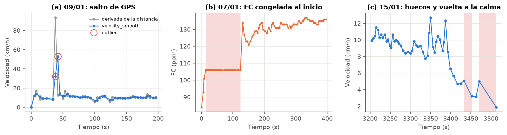
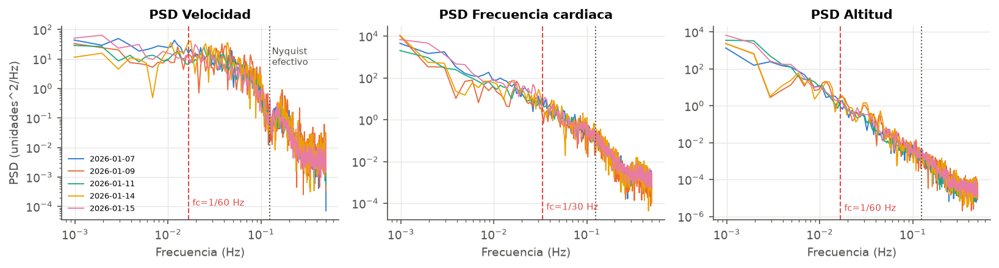
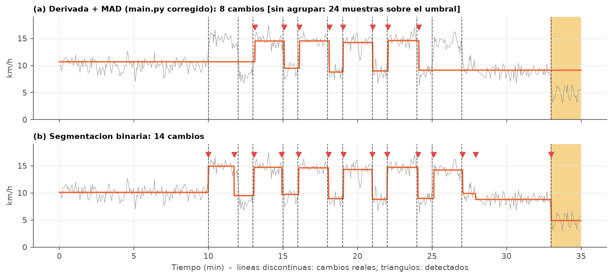
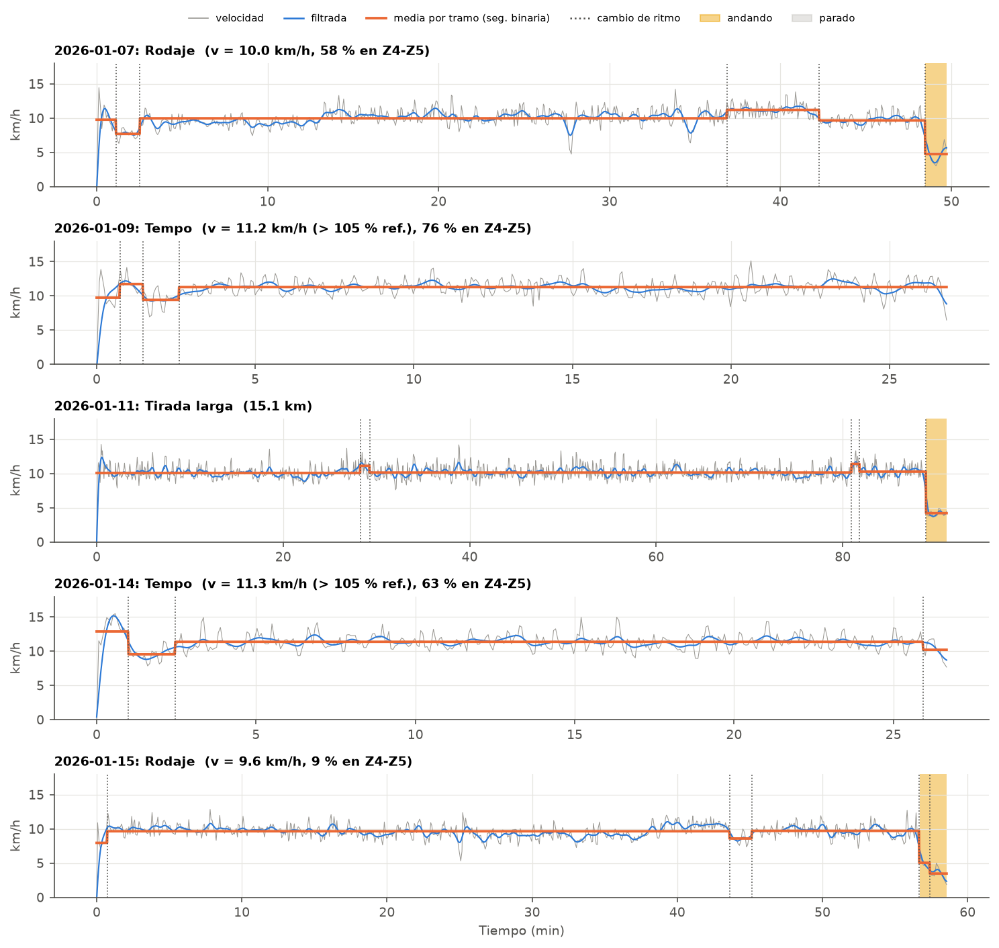

# 1. Descripción de la señal y su origen

Los datos son **cinco actividades de carrera a pie** (7, 9, 11, 14 y 15 de enero de 2026) descargadas de la API de Strava con los scripts de `entrenamiento/`. De cada actividad se usan cinco señales: tiempo (s), distancia acumulada (m, GPS), frecuencia cardiaca (ppm, banda de pecho), velocidad (m/s, `velocity_smooth`, ya suavizada por Strava) y altitud (m).

{width=100%}

Todas las sesiones tienen la misma estructura: arranque rápido, un tramo central a ritmo casi constante (9,5--11,5 km/h) con una fluctuación rápida de $\pm 1$--2 km/h, y en tres de ellas una vuelta a la calma andando. La FC responde mucho más despacio que la velocidad (tarda varios minutos en estabilizarse) y sigue subiendo poco a poco aunque el ritmo no cambie (**deriva cardiaca**). Las sesiones del 09/01 y del 14/01 tienen el mismo perfil de altitud, así que son **el mismo recorrido de 5 km**.

**Muestreo no uniforme.** El reloj guarda un punto cada 2--6 s (mediana 4 s; máximo 42 s). Esto impide aplicar directamente filtros digitales y la FFT, y limita el ancho de banda útil a unos $1/(2\cdot 4\,\mathrm{s}) \approx 0{,}125$ Hz.

{width=100%}

**Anomalías encontradas**:

- *(a)* Un salto de GPS el 09/01 (32 y 53 km/h, imposible corriendo) que además suma unos 100 m falsos a la distancia.
- *(b)* La FC congelada en 106 ppm durante 110 s al inicio del 07/01, seguida de un salto a 134 ppm (la banda todavía no hacía buen contacto).
- *(c)* Cuatro huecos de 19--42 s, siempre al final, cuando el corredor ya va andando y el reloj guarda menos puntos.

No hay valores perdidos ni tiempos desordenados.

# 2. Estrategia de limpieza y preprocesado

1. **Outliers de velocidad**: los que superan un límite físico (25 km/h) o los detecta un filtro de Hampel (11 muestras, $4\sigma$ robustas, solo picos hacia arriba) se eliminan y se interpolan. **La distancia se corrige** en esas muestras: el 09/01 pasa de 5,05 a **4,96 km**.
2. **FC congelada**: se detecta como una meseta de $\geq$ 60 s seguida de un salto de $\geq$ 10 ppm (así no se confunde con las repeticiones normales de la FC entera en régimen estable) y se interpola.
3. **Remuestreo** a una rejilla uniforme de 1 Hz por interpolación lineal, marcando las muestras que caen en huecos.
4. **Filtro paso bajo** Butterworth de orden 2 aplicado con `filtfilt` (fase cero). La frecuencia de corte se elige con el espectro:

{width=100%}

El espectro de la velocidad es casi **plano** (ruido aproximadamente blanco) hasta el Nyquist efectivo, así que lo que hay por encima de unos 0,02 Hz es sobre todo ruido del GPS. Los eventos que interesan (cambios de ritmo, series, paradas) duran al menos un minuto, por lo que elijo **$f_c = 1/60$ Hz** para la velocidad y la altitud, y $1/30$ Hz para la FC, que es más lenta pero tiene ruido de cuantificación.

Para elegir el tipo de filtro los he comparado sobre **sesiones sintéticas** en las que la velocidad real es conocida (escalones con ruido parecido al real, $\sigma \approx 1$ km/h):

{width=100%}

| Filtro | RMSE (km/h) | Retardo (s) |
|---|---|---|
| EMA $\tau$ = 10 s (código de partida) | 1,32 | 9 |
| EMA $\tau$ = 30 s | 1,81 | 20 |
| Mediana 61 s | 0,80 | 2 |
| **Butterworth $f_c$ = 1/60 Hz, fase cero** | **0,93** | **2** |

La EMA del código de partida es causal y retrasa los eventos unos $\tau$ segundos. Me quedo con el Butterworth de fase cero: es lineal (su efecto se puede justificar con el espectro), no retrasa y su error es parecido al de la mediana. Para el desnivel, además de filtrar, aplico una **histéresis de 1 m**. Sin ella el ruido de la altitud infla el desnivel entre un 25 % y un 55 %.

# 3. Características calculadas

Sobre la señal preprocesada calculo indicadores de volumen (distancia, tiempo corriendo), de intensidad (ritmo, % de tiempo en zonas de FC con $FC_{max}$ supuesta de 190 ppm), de regularidad (coeficiente de variación de la velocidad, parciales por km), del terreno (desnivel con histéresis, pendiente en ventanas de 50 m recorridos) y fisiológicos (tiempo de estabilización de la FC, eficiencia en metros por latido, desacoplamiento Pa:FC entre la primera y la segunda mitad). **La cadencia no está en los datos descargados**, así que no se puede calcular (habría que pedir el *stream* `cadence` a Strava).

| Fecha | Tipo | Dist. (km) | Ritmo (min/km) | CV v (%) | FC media | % Z4 | D+ (m) | Desacopl. (%) | m/latido |
|---|---|---|---|---|---|---|---|---|---|
| 07/01 | Rodaje | 8,12 | 6:00 | 9,5 | 149 | 58 | 22 | 1,9 | 1,12 |
| 09/01 | Tempo | 4,96 | 5:23 | 8,3 | 155 | 76 | 10 | 1,6 | 1,20 |
| 11/01 | Tirada larga | 15,14 | 5:54 | 5,7 | 149 | 47 | 61 | 3,9 | 1,14 |
| 14/01 | Tempo | 5,00 | 5:19 | 8,6 | 151 | 63 | 11 | 2,2 | 1,25 |
| 15/01 | Rodaje | 9,13 | 6:14 | 7,8 | 143 | 9 | 34 | 1,0 | 1,12 |

{width=80%}

{width=90%}

Lo más destacable: en la tirada larga los parciales están entre 5:46 y 6:11 min/km sin tendencia a ir más lento, pero la FC sube de 139 a 157 ppm. El **desacoplamiento es del 3,9 %**, por debajo del 5 % que se suele tomar como referencia de buena base aerobica. En las dos sesiones del mismo recorrido, el 14/01 fue **más rápido y con menos FC** que el 09/01 (1,25 frente a 1,20 m/latido). En la subida del 15/01 el corredor fue *más rápido* que en llano, así que fue un cambio de ritmo voluntario y no un efecto del terreno.

# 4. Detección y clasificación

**Estados.** Etiqueto cada muestra con umbrales sobre la velocidad filtrada (parado < 2 km/h, andando 2--7 km/h, corriendo > 7 km/h) y absorbo en el tramo vecino los tramos de menos de 20 s para que la etiqueta no parpadee. Así se detecta la vuelta a la calma en 07/01, 11/01 y 15/01. No hay paradas de más de 20 s en ninguna sesión.

**Cambios de ritmo.** El método de partida (derivada de la EMA y umbral sobre la MAD) tenía varios problemas: contaba como cambio cada muestra que superaba el umbral, tenía errores al dibujar los tramos y, sobre todo, la derivada amplifica el ruido. Propongo una **segmentación binaria**: se supone que la velocidad es constante a trozos más ruido, se busca el corte que más reduce la suma de cuadrados y se acepta si la reducción supera la penalización $\beta = 2\sigma^2\log n$. Los tramos duran como mínimo 45 s y se fusionan los que difieren menos de 1 km/h.

{width=100%}

Resultados en **30 sesiones sintéticas** (tolerancia de 20 s):

| Método | Precisión | Sensibilidad | F1 | F1 ($\sigma$=0,5 / 1 / 1,5) |
|---|---|---|---|---|
| Derivada + MAD (corregido) | 1,00 | 0,56 | 0,72 | 0,99 / 0,60 / 0,21 |
| **Segmentación binaria** | 0,86 | **0,99** | **0,92** | 0,98 / 0,92 / 0,88 |

Con el nivel de ruido real ($\sigma \approx 1$ km/h), el método de la derivada se pierde casi la mitad de los cambios. La segmentación binaria los encuentra prácticamente todos, con un error de localización de 4--5 s (el periodo de muestreo es de 4 s).

**Clasificación de la sesión.** Regla con prioridad, con los umbrales de velocidad relativos a la velocidad habitual del corredor ($v_{ref}$ = 10,16 km/h, la mediana de sus sesiones):

1. $\geq$ 3 bloques rápidos separados por tramos lentos $\rightarrow$ **Series**;
2. si no, $\geq$ 12 km o $\geq$ 75 min corriendo $\rightarrow$ **Tirada larga**;
3. si no, $v \geq 1{,}05\,v_{ref}$ y $\geq$ 40 % del tiempo en Z4--Z5 $\rightarrow$ **Tempo**;
4. en otro caso $\rightarrow$ **Rodaje**.

{width=100%}

Las cinco sesiones reales coinciden con la etiqueta que les puse a mano en el Hito 1, y las 30 sesiones sintéticas (10 de rodaje, 10 de series y 10 de tirada larga) se clasifican todas bien. Hay que tener en cuenta que con solo cinco sesiones reales, y con umbrales elegidos viéndolas, esto no demuestra que la regla generalice. La sesión más dudosa es la del **07/01**: tiene un ritmo de rodaje, pero el 58 % del tiempo en Z4 porque incluye un bloque progresivo de 5 min (+1,2 km/h, min 37--42) que el detector de cambios localiza bien.

# 5. Conclusiones

- La señal de Strava necesita preprocesado antes de analizarla: el muestreo es irregular, hay saltos de GPS que **falsean la distancia** (casi 100 m en una sesión de 5 km), la banda de pecho deja mesetas de FC y el ruido de la altitud infla el desnivel. Todo esto se ha detectado y corregido con criterios explícitos.
- El análisis espectral justifica un paso bajo de $f_c = 1/60$ Hz: por encima de esa frecuencia la velocidad es básicamente ruido blanco del GPS. Un filtro de **fase cero** es mejor que la EMA causal del código de partida (menos error y sin retardo).
- Para **detectar cambios de ritmo**, modelar la señal como constante a trozos (segmentación binaria) funciona mucho mejor que umbralizar la derivada: F1 de 0,92 frente a 0,72, y la diferencia crece con el ruido.
- **Sobre las actividades**: el corredor hace una semana variada con dos sesiones de tempo de 5 km a ~5:20 min/km (el 14/01 mejor que el 09/01), una tirada larga de 15 km muy regular y con poca deriva cardiaca, y dos rodajes, uno de ellos con un progresivo. Ninguna sesión llega a Z5. Las de tempo y la del 07/01 pasan mucho tiempo en Z4, así que si el objetivo es construir base aerobica convendría que los rodajes fueran más suaves.
- **Mejoras posibles**: descargar la cadencia, estimar la FCmáx real, tener más sesiones etiquetadas para ajustar los umbrales (por ejemplo con un árbol de decisión) y usar una penalización adaptativa en la segmentación para poder detectar cambios de ritmo más pequeños.

**Código y resultados**: `02_Codigo/` (paquete `carrera` y un script por hito; `python generar_entrega.py` regenera todas las figuras, tablas y este PDF). Informes detallados de cada hito en `03_Hitos/`. Resumen de indicadores en `04_Entrega_Final/resumen_indicadores.csv`.
